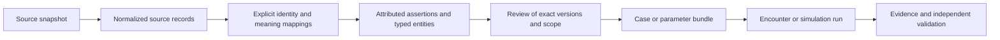

# Hospital ontology v0.1

This is a proposed, extensible domain model for the hospital, its community, and educational scenarios. It is implemented as a typed vocabulary, JSON Schema contracts, a KRAIL projection, and a synthetic example graph. It is **not clinically approved**, a complete hospital inventory, or a calibrated simulator.

The model follows patient journeys while connecting people, authority, facilities, clinical facts, decisions, resources, time, coverage, money, community services, and learning evidence. Broad coverage does not require a separate class for every specialty or consumable: use controlled concepts, capabilities, rules, and role assignments to extend the core.

## Files and authority

| Artifact | Purpose |
|---|---|
| [Domain glossary](../CONTEXT.md) | Canonical meanings for researchers and authors |
| [Vocabulary](../ontology/vocabulary.json) | 63 entity types, 43 relation types, 11 bounded contexts; attributes and outgoing cardinality |
| [Value types](../ontology/value-types.json) | Evidence labels, numeric meanings, coding, uncertainty and distribution conventions |
| [Entity schema](../ontology/schemas/entity.schema.json) | Common envelope plus required, typed, class-specific attributes |
| [Normalized record schema](../ontology/schemas/normalized-record.schema.json) | Source-shaped acquisition interchange; deliberately permits source-specific fields |
| [Relationship schema](../ontology/schemas/relationship.schema.json) | Attributed edges with valid time and qualifiers |
| [Assertion schema](../ontology/schemas/assertion.schema.json) / [source schema](../ontology/schemas/source-record.schema.json) | Narrow entry points for entity consumers |
| [Manifest schema](../ontology/schemas/dataset-manifest.schema.json) | Minimal source catalog compatibility contract; does not force every collector into one detailed manifest format |
| [Competency questions](../ontology/competency-questions.json) | Questions the model must support, needed evidence and limits |
| [Invariants](../ontology/invariants.json) | Declared constraints and which are executable versus planned |
| [Synthetic graph](../ontology/examples/synthetic-journey.jsonl) | 44 invented instances spanning one teaching journey; no real patient/provider identities |
| [KRAIL projection](../.ontology/ontology.yaml) | Native class/property inventory generated from the vocabulary |
| [Validator](../ontology/validate.py) | Schema, reference, selected temporal/evidence checks and invalid-fixture tests |

`ontology/vocabulary.json` owns class/relation semantics; schemas own executable structure. Change them together. `project_krail.py` regenerates the native projection and its edge mapping. JSON syntax in the `.yaml` file is valid YAML. This is a native schema projection, not an OWL reasoner, causal model, clinical validator, or automatic hydration of the data.

## Bounded contexts

| Context | Principal entities | Boundary |
|---|---|---|
| Evidence | SourceRecord, Assertion, ReviewDecision, IdentityMapping | Source statements remain attributed; review targets one immutable version and use scope |
| Organization | Organization, Facility, PhysicalLocation, ServiceUnit, Resource, CapacitySnapshot | Physical layout and organizational services form separate graphs |
| Workforce | Person, RoleAssignment, Qualification, Privilege, Shift | Identity, affiliation, credential, authority and availability are separate facts |
| Clinical | Patient, Encounter, ClinicalConcept, Observation, Order, ActivityDefinition, ActivityPerformance, ClinicalArtifact, ConsentDecision, Perspective | Patient reports, recorded facts, authored truth and discoveries are distinct |
| Workflow | PathwayDefinition, PolicyRule, Decision, Event, QueueEntry, ResourceAllocation, Disruption | Actions require authority/resources and produce explicit events |
| Logistics | InventoryLot, InventoryMovement, Specimen | Equipment is a Resource; medication/blood/supply stock uses lots and audited movement |
| Coverage and finance | InsurancePlan, Coverage, NetworkParticipation, Authorization, FinancialAmount, Claim, Settlement, Appeal | Price, cost, coverage eligibility and payment cannot substitute for one another |
| Community | GeographicArea, PopulationDefinition, CommunityService, DischargePlan, Referral | Municipality residents, county residents, survey respondents and hospital encounters remain separate cohorts |
| Quality | MeasureDefinition, MeasureResult, QualitativeFinding, SafetyEvent | Survey/reporting methods, denominators, suppression and uncertainties stay attached |
| Education | LearningObjective, ScenarioTemplate, CaseVersion, DisclosureRule, RubricVersion, Assessment, EvidenceArtifact, EvaluationCase | Approved case facts and learner-visible state remain separate |
| Simulation | Parameter, SimulationRun, ValidationStudy | Data, assumptions, fitted distributions, model outputs and independent validation remain distinct |

A payer and a post-acute partner are Organization records. A hospital bed is a Resource located in a PhysicalLocation; a bed space can itself be a location. Interpreters, transporters, environmental services, schedulers and billing workers use the same Person/RoleAssignment/Shift model as clinicians. Diagnostic tests, consultations, transport and cleaning use ActivityDefinition/Order/ActivityPerformance with different concepts and resource requirements. A diagnosis, symptom, allergy or history fact uses Assertion referring to a ClinicalConcept, rather than dozens of nearly identical fact classes.

## Source to knowledge to scenario



Acquisition records in `normalized/*.jsonl` retain source-specific columns under `data`, source identifiers, retrieval time and raw hash. They are not required to pretend to be ontology entities. The acquisition schema permits additional collector labels for `evidence_kind` and `review_status`; promotion must map these explicitly to the ontology vocabulary. A collector's `reviewed` value never implies faculty approval.

Promotion creates explicit typed entity candidates and assertions, records transformation/locators, reconciles identity through IdentityMapping, and records intended use. It does not rewrite raw records. A SourceRecord may identify a document, data release or endpoint snapshot. A paragraph summary, tabular observation, provider directory row, and fitted duration distribution have different evidence meanings.

Recommended lineage: `source_id` identifies the source/release family; the raw hash identifies retrieved bytes; `record_id` identifies the normalized row; an entity uses an opaque stable ID and a version. Published immutable bundles pin the exact versions. A snapshot file must contain one version of an entity ID; archives retain older snapshots. Foreign references in multi-version databases must later resolve to pinned versions explicitly. Do not join on name alone or treat a URL as a stable provider identity.

The supplied sample normalizer contract is:

```json
{
  "record_id": "source-slug:stable-row-key",
  "source_id": "source-slug",
  "source_record_id": "original-key-or-null",
  "record_type": "source_specific_type",
  "data": {},
  "provenance": {
    "source_url": "https://example.org/source",
    "retrieved_at": "2026-10-10T12:00:00Z",
    "raw_sha256": "<64 lowercase hexadecimal characters>"
  },
  "evidence_kind": "published_directory",
  "review_status": "unreviewed"
}
```

This is a contract illustration, not a valid acquired row: the placeholder hash must be replaced with the hash of actual source bytes. A null source record ID is permitted when no original key exists; it does not replace a unique normalized record ID.

## Decisions that prevent semantic errors

**Time has several meanings.** Store occurrence/effective time, database recording time, source publication time, retrieval time and valid interval separately. Events use timezone-bearing timestamps. Monthly and annual source reporting periods should retain original labels and precision; do not fabricate precise instants from them. A public historical capacity count cannot populate a live CapacitySnapshot without a scoped assumption. Keep unfinished waits and censoring, cancellations and reporting delay.

**Assertion state is independent of its origin.** A patient-reported allergy may be present as a report while clinical confirmation remains unknown. Use separate assertions with attribution. `explicitly_absent` is an explicit finding; missing and pending are not negative. Qualitative themes need method, population, context, date/period and source locator. Preserve conflicting accounts as separate records sharing a conflict identifier; a reviewer resolves an exact scope rather than erasing earlier statements.

**Organizational units can span locations.** A cardiology service can work in more than one wing, and a physical room can host different services over time. Facility/campus/legal-operator/CCN differences require identity mappings and dated reporting scopes. The physical containment relation must remain acyclic.

**A doctor is not a schedule.** An NPI directory row can support identity/taxonomy assertions. An affiliation record can support a dated affiliation. Neither establishes credential verification, privileges, on-call status, current shift, patient assignment or personality. Public real people should not silently become generated behavioral personas.

**An order is not a completed procedure.** ActivityDefinition carries prerequisites and required resources; Order requests it; ActivityPerformance records its actual or simulated execution. Procedure codes, clinical concepts and payment groups are mappings, not interchangeable activities. Consent, specimen collection, result release and result acknowledgement are distinct events.

**Insurance is contextual.** Facility participation does not establish professional participation. Coverage is patient-specific and date-bound. Authorization has a scoped decision and can expire; it is not payment. Price files need payer/product/setting/billing-component/code-version context. `gross_charge`, `negotiated_rate`, `allowed_amount`, `resource_cost`, `reimbursement` and `patient_liability` are explicit distinct amount kinds.

**Aggregate evidence is not individual truth.** Counts need denominator, geography, period, suppression, population inclusion/exclusion and adjustment method. New Brunswick residents, Middlesex residents and patients treated at RWJUH are different populations. A community prevalence or HCAHPS score must not become an individual patient's diagnosis or a per-encounter behavior probability.

**Parameters must state applicability.** Keep a scalar, empirical distribution, parametric fit and conditional model distinguishable. Preserve units, conditioning variables, sampling/error method, sample size, uncertainty and censoring. Empty dependence references mean unspecified dependence, not independent sampling. Parameter sourcing supports identity, teaching, exploratory assumptions, calibration or validation only within its documented scope.

**Clinical and teaching approval are versioned.** An approved label requires an exact-version ReviewDecision; the validator checks that linkage but cannot establish that the reviewer is qualified or actually human. CaseVersion enumerates facts and disclosure rules; encounter actions reveal facts without regenerating them. New clinical relationships remain drafts. Rubric scoring links to observable EvidenceArtifacts and records insufficient evidence separately from a failed criterion.

## Cardinality, constraints and extension

Relationships specify outgoing cardinality. `1` is exactly one, `0..1` optional single, `0..*` unbounded optional, and `1..*` at least one. IdentityMapping's two endpoints are the exceptional `2`. Reverse cardinalities are generally unbounded unless the invariant registry specifies exclusivity over time. Reference attributes and explicit relationship records are two representations of the same link: do not double-count them.

Required attributes and primitive types are executable JSON Schema constraints. Nested policies, conditions, distributions and criteria remain structured objects whose semantic DSLs are deliberately deferred; they must not be executed as trusted instructions. The local checker covers selected graph/time/evidence invariants, not all relation cardinalities or clinical constraints. Resource conservation, authority at execution, inventory balance, coverage calculations, privacy/right-to-use decisions, distribution fit and human review need dedicated validation before simulation or publication.

To add a domain detail, first try a concept, role code, capability, policy or measure definition. Add a new class only when it has a different identity/lifecycle. Add a competency question, example, source requirement, mapping rule and invariant with each substantive extension. Keep crosswalks and source uncertainty visible.

## Verification

From the repository root:

```sh
python3 data/ontology/project_krail.py
python3 data/ontology/validate.py
python3 data/ontology/validate.py --normalized-dir data/normalized
```

The validator uses the `jsonschema` Python package. It checks schemas, vocabulary endpoints, projection freshness, the synthetic graph, selected invariants and rejection of eight invalid fixtures. The optional acquisition check validates envelopes and unique record IDs; it does not verify that source bytes are still present or actually match their hashes. The acquisition workflow owns raw integrity checks. Example values are arbitrary and all examples remain `draft` / `synthetic_example`.

## Research basis

The model refines the repository's [whole-hospital blueprint](../../research/whole-hospital-data-blueprint.md) and [ontology-first plan](../../research/ontology-and-knowledge-base-plan.md). Those documents contain primary-source routes and acquisition limitations. This design introduces no claim that the class model conforms to all of FHIR, SNOMED, OMOP, OWL, or a hospital's local operational schema. Source terminology versions and redistribution permissions must remain attached to any future mappings.

## Preliminary acquisition mappings

The first source pack uses the record types below. These are **mapping proposals**, not a claim that the collected rows already form a reviewed graph. Preserve each original row and add typed candidates only after checking identifiers, field definitions and periods.

| Acquired record type | Ontology projection | Review needed before promotion |
|---|---|---|
| `Facility` / `FacilityAssertion` | Facility, Organization, Assertion, IdentityMapping | CCN/license/campus/legal-operator scope; assertion origin and reporting date |
| `Practitioner` | Person + Qualification candidate + identity identifiers | Public identity only; taxonomy is not credential verification; do not create shifts/personality |
| `PractitionerAffiliation` | `affiliated_with` relationship + source assertion | Facility identifier and date reconciliation; no privilege inference |
| `CapacityAssertion` | Assertion; CapacitySnapshot only if observation time/basis adequate | Licensed/physical/staffed meaning, scope, date; never populate current live beds from a website |
| `ServiceCapabilityAssertion` | ServiceUnit candidate + Assertion | Service identity and source designation; location mapping may remain unknown |
| `QualityMeasureObservation` | MeasureDefinition + MeasureResult + PopulationDefinition | CMS measure, numerator/denominator, reporting period, adjustment, suppression |
| `UtilizationObservation` | MeasureDefinition + MeasureResult + PopulationDefinition | Facility versus residence basis; period, payer scope, count/suppression and diagnosis versus presenting complaint |
| `PopulationEstimate` | GeographicArea + PopulationDefinition + MeasureResult | ACS/PLACES method, vintage, denominator, margin/interval, modeled versus measured |
| `TerminologyLookup` | ClinicalConcept with versioned coding | Meaning/equivalence, terminology release and reuse rights |
| `SyntheticPatientProfile` | Patient + CaseVersion candidate + attributed Assertions | Preserve authored synthetic origin; reconcile facts and seek scoped clinical/faculty review |
| `NetworkParticipationAssertion` | NetworkParticipation + InsurancePlan candidate + Assertion | Product, facility/professional component, dates and service scope; keep unknown plan identity unresolved |
| `PolicyAssertion` | Assertion + PolicyRule candidate | Policy version, applicability and rights; no automatic execution of textual policy |
| `QualitativeFinding` | QualitativeFinding + SourceRecord | Method, population/context, locator, disagreements and reporting period |
| `ResearchMethod` / `DatasetScopeAssertion` | SourceRecord metadata + Assertion or PopulationDefinition | Distinguish methods description from actual acquired observations |

Normalized labels such as `published_source_assertion` map to `published_directory`, `published_policy`, `qualitative_research` or `published_reference` only after inspecting the claim. Preserve the original label in the normalized record. Labels such as `source_extracted_not_domain_reviewed` map to entity `unreviewed`, never `approved`.

A limited factual paraphrase may have `provenance.raw_sha256: null` when no raw document is retained. In that case `acquisition_method` is required and must explain the limitation; source URL, timestamp and locator remain important. This exception does not claim byte-level reproducibility or possession of the original document. Hash-bearing rows must refer to actual acquired bytes, not a hash invented from the paraphrase.
