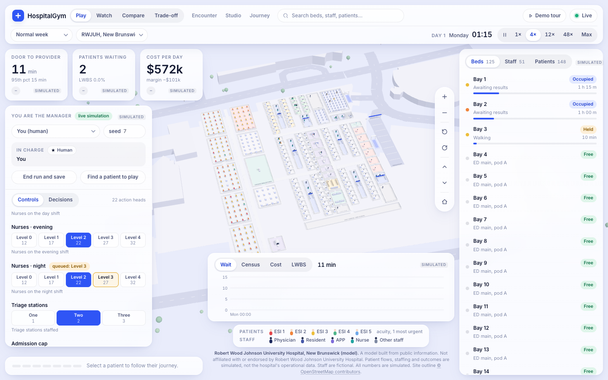
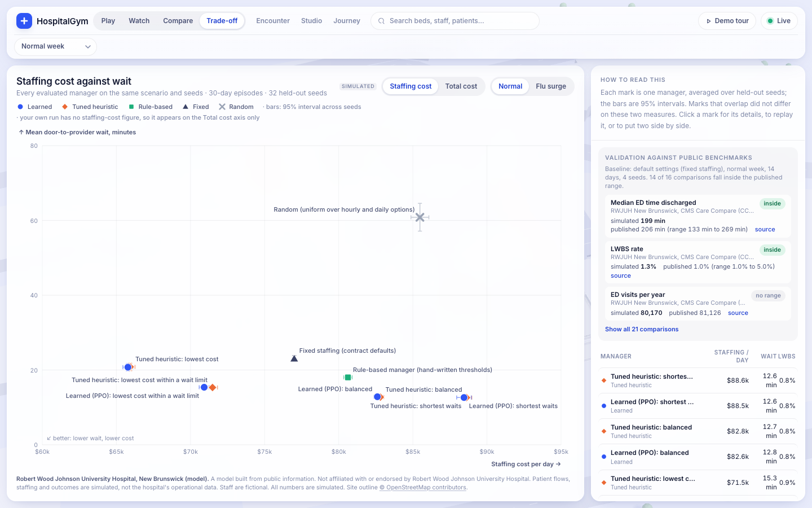
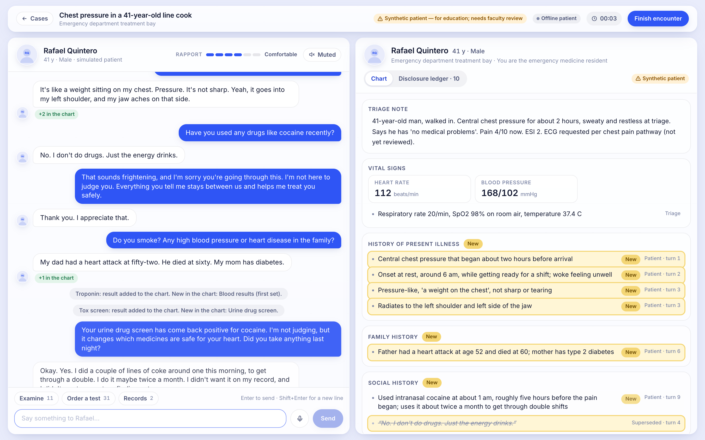
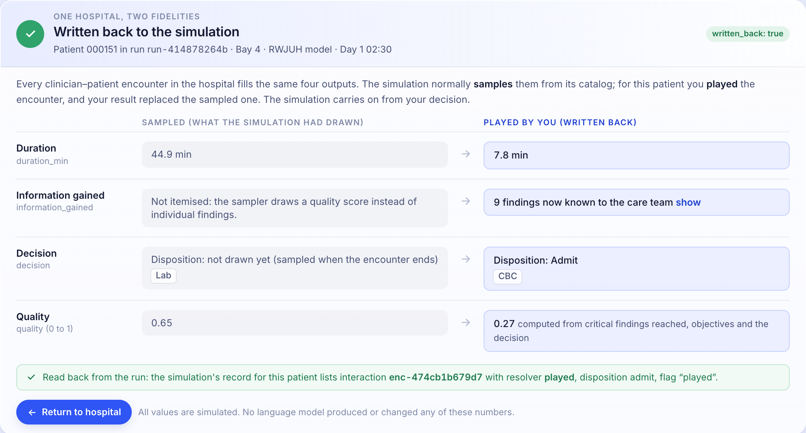
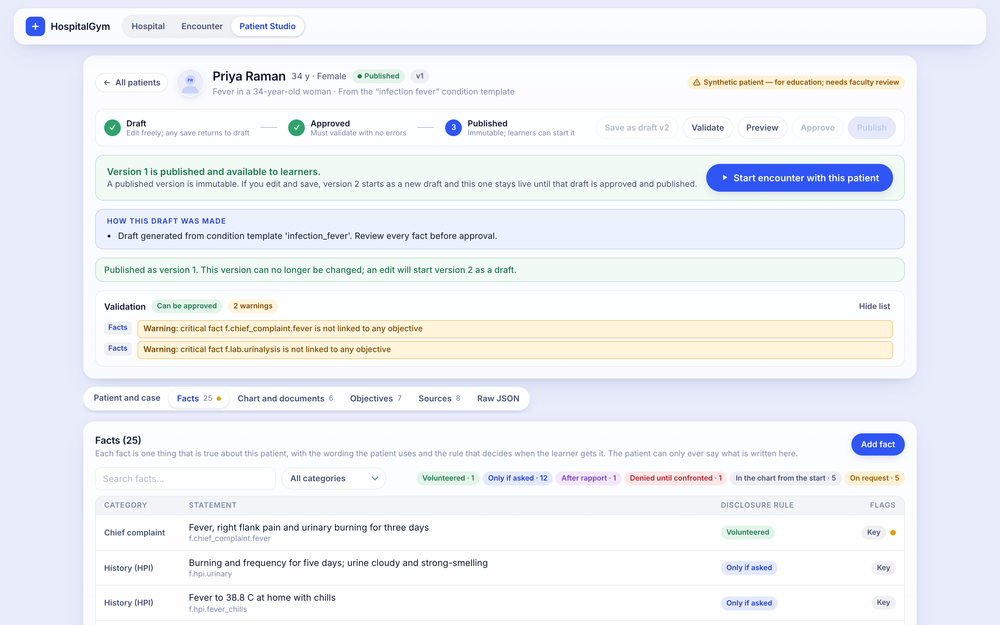
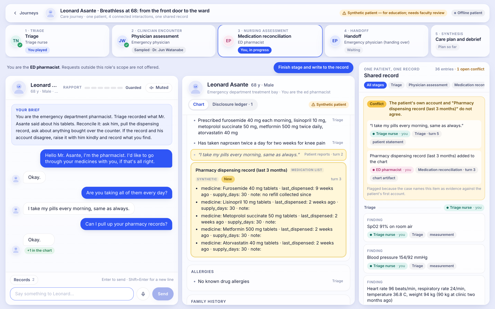

# Morning report — Saturday 10 October 2026

Written at 09:45. Submission is Sunday noon.

## What happened overnight

The build ran from 00:59 to about 04:10 and then stopped: the account's usage limit was hit, which ended three working agents and the orchestrator. Nothing ran on the Mac between 04:10 and 09:08. Training on deepstack kept going and finished at 05:44. You restarted the session at 09:08 and the interrupted work was finished between 09:10 and 09:45. So this is about three and a half hours of orchestrated work, not seven, and the wrap-up happened after you woke rather than before.

Everything is committed on `aryan`. Nothing was pushed, deployed, or spent.

## Run it

```bash
./run_server.sh     # http://localhost:8000
./run_web.sh        # http://localhost:3000
```

Neither is running: the wrap-up started both, ran the checks below, and stopped them. First-time setup is in the [README](../README.md). Pages: `/` (3D hospital), `/encounter`, `/studio`, `/journey`.

One rule that bit us: do not run `pnpm --dir web build` while `next dev` is running. It corrupts the dev server's `.next` and pages start returning 500.

## What works, and how it was checked

| Piece | State | How verified |
|---|---|---|
| Simulator (`sim/`) | Batched PyTorch model of an ED plus ward pool; 22 action heads at four cadences, all reported implemented; common random numbers; conservation; structural changes with build delays | Mac: 15 passed, 16 skipped (GPU variants). deepstack: 31 passed on CPU and CUDA including the 120-day structural test (agent-run). A golden-trajectory test confirms dynamics did not change after the freeze at 02:50; I re-ran it. A 1000-day run of 64 hospitals completed with zero conservation residual. Idle GPU: 389 hospital-days/s at batch 4096. |
| Server (`server/`) | Every contract route, live websocket, rejoin a run after a reload or tab change, queued write-back, playable-patient lists | 43 tests, re-run by me. Smoke script 47/47 (agent-run). |
| Encounter engine (`encounter/`) | Cases as data with validation and a draft → approved → published lifecycle, disclosure engine with a ledger, offline patient, grader, write-back, three seed cases, nine condition templates | Part of the 222-test combined run below. Offline probes: 46/48 on the development set; 0 of 194 patient sentences unsupported. |
| Care journey (`encounter/journey/`, `/journey`) | Four connected stages on one shared record with provenance, SBAR handoff with an AI colleague, care plan and team debrief | 18 tests; browser e2e 41 checks (agent-run). Not looked at by QA. |
| Combined Python suites | | `encounter + journey + server`: 222 passed. In a **clean virtualenv built from `requirements.txt`**: 241 passed (adds `rl` and data adapters) and simulator 15 passed. |
| Web (`web/`) | Play, Watch, Compare, Trade-off, inspector with catalog sources, demo tour, Patient Studio, encounter, journey | `pnpm build` passes (run by me at 09:38). At 09:35–09:45 I started both servers with the two run scripts and ran `web/scripts/screenshots.mjs` against them: every step completed with no page errors, including the one-tab path Play → find a playable patient → play the encounter → finish (write-back "Applied") → return to the same run with the patient selected and the clock advancing; reload-and-rejoin; a human run saved to the trade-off chart; live compare; a structural change rebuilding the layout (beds 125 → 129 on day 71); and all six demo-tour steps. Encounter e2e 56/56 (agent-run). |
| RL (`rl/`) | Gym wrapper, three baselines, five tuned heuristics, PPO, held-out evaluation, 40 recorded rollouts | 14 tests, re-run by me. 20 managers load on the Mac CPU; the server lists 21 including `human`. |













The web screenshots were re-taken at 09:35–09:45 from the final build. To regenerate: with both servers up, `node scripts/screenshots.mjs http://localhost:3000 --gpu --api http://localhost:8000` from `web/` (about 12 minutes).

## What is partial or broken

Read [QA_REPORT.md](QA_REPORT.md): an independent agent walked the demo at 03:00 and listed 4 demo-breaking and 17 visible defects. A fix round addressed all four P0s and most P1s, **but QA has not been re-run since**, so "fixed" below means fixed and checked by the agent that fixed it.

- **Not re-verified after the fixes:** Studio "from a description" (D4; now keeps only what the text states — tests pass, no browser re-check), queued and rejected write-back states (only "applied" was seen in the browser), the warning-acknowledgement dialog on approve, rejoin after a run has expired, two tabs on one run.
- **Offline patient quality.** Improved a lot in round 2 (the canned "I'm not sure" line went from 73 of 140 replies to 0 of 42 on QA's own questions), but that second probe set is not blind: the engine was changed in response to it. Expect rough replies on unusual phrasing.
- **Default "no" answers.** The offline patient now answers "no" to standard yes/no questions the case does not define. It is flagged in the ledger and can be switched off per case. This is a policy choice you should confirm with faculty.
- **Organizer sample patients appear by default** on `/encounter` and `/studio` when `.private/` is present (as the handoff asked), with names and photos; their auto-converted wording is uneven. They are never in tracked files or committed screenshots. Decide whether to show them in the demo.
- **Wait-time tail is too short.** Simulated 90th-percentile wait is 40 min against 63–118 in the survey.
- **Cost barely responds to the manager** in total-cost terms, because measured overhead dominates; the trade-off chart defaults to staffing cost for that reason.
- **People render black in live Compare.** Visible in this morning's `screenshots/web-live-compare-two-managers.png`: in the right-hand pane every person is black instead of coloured by acuity or role. The same bug appeared earlier after layout changes and was worked around by remounting; the root cause is not known (it needs shadows on and people meshes outliving a rebuild of the building). Recorded-rollout Compare was not seen to do this. Fix before demoing live Compare, or use recorded rollouts.
- **Web, smaller:** KPI labels truncate at 1280 px; fixture-mode auto-recovery is untested.
- **Simulator not modelled:** MRI and ultrasound, staff turnover, the results-waiting area, a dedicated fast-track nurse; `relocate` changes walking distances only; the two contrast hospitals run but are uncalibrated; per-hospital scenario mixing in one batch was not done.
- **Never run against a real service:** Bedrock, Anthropic, ElevenLabs, Vlada. No credentials were set; those adapters are tested against faked responses only. Voice in the browser is implemented but unexercised.

## Managers: results on held-out seeds

All numbers are simulated. Protocol: 32 seeds never used in tuning or training, 30-day episodes, every manager on the same seeds. Full tables with confidence intervals and objective weights: [rl/results/RESULTS.md](../rl/results/RESULTS.md).

| Manager | Kind | Normal week: mean wait (min) / LWBS / staffing $k per day | Flu surge |
|---|---|---|---|
| `fixed` | fixed | 23.1 / 1.42% / 77.0 | 38.5 / 2.53% / 76.3 |
| `rule_based` | rule-based | 18.0 / 1.13% / 80.6 | 22.4 / 1.42% / 82.2 |
| `tuned_min_cost` | tuned heuristic | 130.6 / 8.65% / 56.2 | 192.9 / 12.69% / 55.9 |
| `tuned_min_wait` | tuned heuristic | 12.2 / 0.77% / 91.5 | 12.5 / 0.79% / 91.9 |
| `tuned_max_margin` | tuned heuristic | 23.5 / 1.46% / 66.6 | 35.2 / 2.19% / 66.8 |
| `tuned_balanced` | tuned heuristic | 12.7 / 0.79% / 82.8 | 13.0 / 0.81% / 85.3 |
| `tuned_cost_p95` (cheapest with p95 wait ≤ 60 min) | tuned heuristic | 15.7 / 0.99% / 69.6 | 18.3 / 1.14% / 72.0 |
| `ppo_scratch_min_cost` | learned | 694.7 / 31.5% / 50.3 | 820.5 / 35.9% / 50.0 |

Plainly:

- **The tuned heuristics are the real result.** Each beats the fixed and rule-based baselines on its own objective, and they now differ visibly: the cost-minded one cuts staffing by about a quarter and waits go from 23 to 131 minutes; the wait-minded one staffs up and waits halve. The constrained one is the sensible middle. That is the demo's story, and it is shown by tuned heuristics, not learned agents.
- **The learned agents do not beat the tuned heuristics in any way worth claiming.** The five PPO agents warm-started by behaviour cloning mostly *match* their teachers; where the verdict says "beats" the difference is around 0.001 in score, i.e. they are effectively copies. `ppo_cost_p95` beats its heuristic on a normal week and **loses under the flu surge**, breaking the 60-minute constraint on 44% of seeds.
- **One PPO agent trained from scratch (`ppo_scratch_min_cost`) does beat its tuned heuristic on its own objective** — which is staffing cost alone — by finding a lower floor and letting the hospital collapse (695-minute waits, 31% leaving unseen). It did exactly what it was asked. Good for the pitch's "the metric is the decision" point; not a manager anyone would want.
- Every learned agent beats `rule_based` on its own score.
- PPO runs got 2.0–4.2 million steps each; training used 10- and 14-day episodes. Weekly and monthly (structural) decisions were **not** trained; the weight-conditioned agent exists with four presets but there is no live slider.

## Catalog provenance

348 attributes (excluding validation targets): **85 measured, 29 literature, 234 assumed** (24% measured).

| File | Attributes | Measured | Literature | Assumed |
|---|---|---|---|---|
| patient | 88 | 41 | 4 | 43 |
| staff | 52 | 10 | 9 | 33 |
| space | 91 | 3 | 4 | 84 |
| equipment | 53 | 4 | 3 | 46 |
| event | 16 | 3 | 3 | 10 |
| hospital (RWJUH) | 48 | 24 | 6 | 18 |

Measured sources: NHAMCS ED 2019/2021/2022 (51,713 visits), CMS Care Compare, Provider of Services, cost reports, IPPS FY2027, OPPS July 2026, BLS OEWS May 2025, ILINet. Validation against public benchmarks (default policy): median ED time for discharged patients 190 min against RWJUH's 206 (peer range 133–269, inside); LWBS 1.4% against 1% (peers 1–5%, inside); median wait 15 min against 17; 90th-percentile wait outside.

An independent audit re-fetched all 23 literature-backed catalog values (22 verified, 1 mismatch corrected) and 15 of 78 evidence records (all verified). **63 evidence records were not audited.** The BLS absence table was transcribed through a fetch tool and should be re-checked in a browser.

The hospital layout is a reconstruction: no real interior plan was found. Site outline and roads come from OpenStreetMap; 114 rooms are tagged `published` (the hospital states the zone or count), 34 `inferred`, none `surveyed`. Things to verify by eye: walk-in and ambulance door positions, the pediatric count of 17, the assumed counts for triage, fast track, resus and scanners.

## deepstack

Nothing is running. GPU idle, tmux session `hospitalgym` has only a bash window. Work is in `~/projects/hospitalgym_aryan/` (`runs/` holds training logs and checkpoints; `data_work/` 806 MB of downloads; `sim/_scratch/`). To regenerate evaluation and rollouts from the existing checkpoints: `rl/scripts/refresh_all.sh` (about 10 minutes). Full rebuild: `rl/scripts/remote_regen.sh`. Note: a plain rsync of the repo to deepstack overwrites `rl/policies` and `rl/reward_scales.json` there; the installer restores them from `runs/`.

## Decisions made on your behalf

- **Rewrote unpushed local history twice, both times to remove organizer names.** First, a test file hard-coded the organizers' sample-patient and clinician names and went into two early local commits: I fixed the file and squashed tonight's commits from that point. Second, the QA report quoted a clinician profile name: I redacted it and rewrote the nine commits that contained the file. After each, I checked that no commit reachable from `aryan` contains any of those names (0 of 24 commits ahead of `origin/main`). The old objects still exist in this Mac's reflog; a normal `git push` of the branch does not send them.
- Tracked cases and screenshots use only our own synthetic patients. Organizer material is read from `.private/` at run time.
- Froze simulator dynamics at 02:50 so training had a stable target; later simulator work was held to a golden-trajectory test.
- Redefined the manager objectives after QA found them indistinguishable: `min_cost` is staffing cost only, `min_wait` has no cost term, added `max_margin`; the constrained threshold is p95 wait ≤ 60 minutes. Added a `labor` reward term to the contract.
- Downstream capacity is one 168-bed ward pool, not the whole hospital; three 8-hour shifts.
- Approve is a soft gate: warnings are shown and must be ticked, but a thin case can still be approved.
- Bedrock default model `us.amazon.nova-pro-v1:0` (what the workshop account lists), Anthropic default `claude-opus-5-5`; both configurable in `.env`.
- Cleared agent-made test rows from the human-run store and deleted QA's test cases from the gitignored runtime store.
- Spent time on an independent citation audit and an independent QA pass rather than more features.

## Proposed plan to Sunday noon

1. **Now (1 hour): walk the demo yourself** in one tab — fly over, Play, hand over to `tuned_min_cost`, Compare with `tuned_min_wait`, Trade-off, click a bay and a nurse, "Find a patient to play", play it, return. Then Studio: create a patient from a description, publish, run it. Note what breaks; that list outranks everything below.
2. **Re-run QA** on the fixed build (the brief is reusable) and close what it finds. Highest risk: the Studio description path and anything in the encounter that a faculty judge will type.
3. **Put in credentials** (AWS workshop account or an Anthropic key) and test the online patient and grader. This has never run for real and is the largest unknown; the offline patient is serviceable but stiff.
4. **Merge with Akash.** The contracts use his vocabulary (fact IDs, the four objective labels, the ledger, separate faculty/patient/learner/rubric views). Agree which Studio and encounter pages are the submission's.
5. **Get one faculty review** of a seed case and of the default-negative policy.
6. **Decide the pitch.** Suggested: Challenge 1 is the judged core (Studio → encounter → feedback, new patient live); the hospital is why it is different (the patient is in a bed in a running hospital and your result is written back); the trade-off chart with the collapse-the-hospital agent is the closer. Do not claim learned agents beat heuristics.
7. Record the fallback video Saturday evening; freeze features by then.
