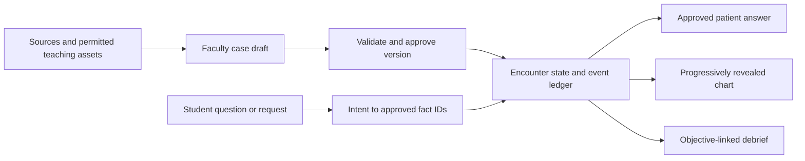

# TwinVerse: locked weekend action plan

Prepared October 9; refined October 10, 2026, America/New_York. Team confirmed TwinVerse registration and five teammates; individual names/skills remain unassigned. **Submission: Sunday October 11 at noon EDT. Internal target: all materials ready at 11:00 a.m.; submit and verify by 11:30 a.m.** The [correct-year official brochure](https://www.ruhealthhack.com/brochure) supports noon, although it is preliminary. Ignore the conflicting 5 p.m. Devpost display for planning.

**This public research snapshot incorporates the sponsor guides, both TwinVerse challenge documents and architecture videos, the Vlada catalog/guide, hospital-context sources, and the team's AWS access steps.** Workshop console access and listed Nova models/quota have now been inspected; successful inference, credits and app deployment remain unverified. See the [live resource assessment](resource-feasibility-2026-10-10.md). Requirements, evidence, proposed implementation and future validation are distinguished throughout. See the [source register](source-register.md) for provenance; original private material is not included.

## October 10 current preparation sequence

Start with a project KRAIL, ontology and teaching knowledge base; database design and AI scenario generation follow. See the [ontology plan](ontology-and-knowledge-base-plan.md) for acquisition priorities, entity relationships and proposed readiness gates, and the [Codex synthesis](codex-project-synthesis.md) for cross-thread decisions. This is preparation for the reusable encounter contract, not evidence these layers are implemented.

The later [dataset review](discord-dataset-review-2026-10-10.md) supersedes the missing-organizer-assets finding: eight synthetic profiles, faculty seed rows and the supplied rubric are acquired drafts. Prefer a mentor-reviewed supplied nutrition/communication case for the first encounter; acute ER adaptations need new reviewed content.

## Decision

Build **ER Encounter Studio**: a faculty member creates and approves a synthetic patient; a student interviews that patient beside a progressively revealed chart; the debrief explains elicited and missed findings, interview quality, and communication using the faculty's objectives and the student's actual interaction.

This is a working product name and a recommended selection of **TwinVerse Challenge 1: The Virtual Patient Encounter**. The team confirmed the track; the exact subchallenge remains to be confirmed. Confirm that selection with the mentor immediately; the implementation plan below targets Challenge 1. Challenge 2 would instead require three or more connected encounters and a shared multidisciplinary state.

**Demo promise:** “Create a new patient live, run an encounter immediately, and trace every clinical answer, chart finding, and feedback item to the approved case or interaction.” The new-case flow is core functionality, not a late stretch feature. The supplied challenge deck explicitly requires it (page 6).

The detailed Challenge 1 document now establishes required deliverables: **working prototype, code repository including infrastructure code if applicable, short demo video or live demonstration, and a four-minute pitch** covering solution, architecture, technical approach and educational value. It also supplies evaluation considerations: architecture/reusability, patient-profile quality/clinical validity, technical innovation, user experience, encounter quality and explainable feedback. Numeric weights and submission-form specifics remain unverified. [Package review](twinverse-requirements.md)

The recording's broader hospital world remains the vision: doctors, nurses, procedures, equipment, patient histories, and eventually operational scenarios. For this weekend, the setting is a single ER encounter. A ward shell or patient queue can provide context after the core works. Staffing optimization, insurance, whole-hospital flow, and physiologically predictive treatment simulation require separate models and validation and belong after the hackathon.

## October 10 research and execution refinement

The [ChatGPT project synthesis](project-research-synthesis.md) consolidates fifteen research conversations. The [Luna workflow pack](luna-data-workflows.md) and [acquisition manifest](data-acquisition-manifest.json) preserve the whole-hospital data ambition across staged jobs. These are research contracts and prompts; no acquisition pipeline or Luna invocation has run.

Use Encounter Studio for approved clinical state, a later Operations Lab for numerical DES consequences, and Hospital World for presentation of their shared entity IDs. Complete Challenge 1 first. Prepare/cache the next approved patient before use; newly generated profiles remain drafts until review. Keep teaching, simulated and wall-clock time distinct. Existing chart records and available urgent findings should not be locked behind interview keywords.

Prefer a mentor-selected stable possible-ACS interview over a treatment simulator. The project's separate STEMI source pack cannot be combined with its unresolved possible-ACS draft without clinical review. Core feedback uses objective-level met/partly demonstrated/not observed/not assessable with source evidence and separate safety flags. Competing numerical rubric totals remain unvalidated proposals.

For research jobs, GPT-6 Luna is preferred. Official documentation lists a possible Bedrock route in us-east-1, but workshop invocation permission and budget have not been proved. Attempt one bounded synthetic endpoint test before scaling. Use the existing authored-case/local fallback if provider access blocks progress. Do not allow the broad acquisition backlog to delay Sunday's authoring/encounter/debrief demo.

## Brainstorm findings and scope decisions

The team's brainstorm was machine-transcribed locally, with uncertain wording marked. The public [decision summary](recording-and-decisions.md) captures its substantive ideas; the source audio and full transcript remain private.

| Recording section | Idea | Weekend decision |
|---|---|---|
| 00:00–00:55 | Interactive hospital world with staff, patients, equipment, floor plans and insurance | Use a compact ER context; model one encounter |
| 00:55–01:54 | Synthetic histories and test material; chart resembling a clinical record; cases supported by papers/data | Faculty-approved structured case, attach approved materials, explicit provenance |
| 02:29–03:20 | Map the doctor's encounter flow; start ER; prepare the next patient to reduce waiting | History -> chart/exam/test reveal -> learner summary -> debrief; load approved case instantly |
| 03:27–04:01 | Nurse/patient perspectives | Future role expansion; no separate role engine now |
| 04:14–05:05 | Administrator changes staffing and studies patient flow | Future discrete-event simulation project |
| 05:11–05:34 | Coherence and evidence distinguish it from a quick generic generation | Make cross-channel consistency and traceability the demonstration |

The visit-duration examples in the audio are hypotheticals, not measured clinical service times. A research-backed case does not require access to identifiable patient records or Epic. The prototype uses synthetic cases and approved/licensed teaching material.

## Research conclusion

There is a defensible education use case, but research does not validate our unbuilt product. The eCREST feasibility trial enrolled 264 students and found improved essential information gathering in an analyzed subset; a larger effectiveness trial was still needed. [Original trial](https://pubmed.ncbi.nlm.nih.gov/32736583/)

The competitive field is substantial. [Body Interact](https://bodyinteract.com/virtual-patient-simulator/) offers clinical simulation, and [Full Code Creator](https://fullcodemedical.com/faq/) already supports faculty case authoring. The detailed [research dossier](clinical-research.md) compares official product capabilities and original studies. “AI patient with voice and a chart” or “create a new case without code” is insufficient novelty. Our proposed contribution is a faculty-controlled, inspectable case contract with consistent progressive disclosure and evidence-linked formative feedback. Whether it is educationally better or cheaper must be measured later.

[AgentClinic](https://arxiv.org/abs/2405.07960) demonstrates interactive simulated clinical environments; [MedAgentBench](https://arxiv.org/abs/2501.14654) demonstrates a virtual EHR task environment. These are useful architecture/evaluation precedents, not proof that chat-generated facts or grades are reliable. Our state and factual answers must come from the approved case.

## Supplied resources and how to use them

The ZIP supplies two challenge documents and two architecture videos. **It does not contain starter code, a JSON schema, patient datasets, learning-objective files, or prompts.** The Challenge 1 document promises access to synthetic personas, existing VHS prompts, sample encounters/case materials, learning objectives, documentation templates and Bedrock access/credits. A later separately posted bundle now provides patient profiles, faculty seed data and an example rubric; see the [dataset review](discord-dataset-review-2026-10-10.md). Reconcile and review those drafts, and request any still-missing VHS prompts, encounter examples and documentation templates. The actual schema below remains our implementation proposal.

The architecture videos explain a broader platform, including shared state, provenance and SBAR/team collaboration. One Challenge 1 video slide describes voice/SBAR as an Enhanced tier, while the written Challenge 1 document places voice under Stretch and specifies no Enhanced tier. Follow the written Challenge 1 Base for the submitted scope and clarify that discrepancy with the mentor. Challenge 2's three-plus encounters, professional roles and synthesized care plan remain an alternative project, not extra Base work for this one.

The first video also illustrates a discrepancy between patient self-report and a chart finding. Include that only when faculty deliberately authors both observations and the teaching objective. Preserve their separate provenance and uncertainty; the model must not invent contradictions or infer nonadherence from a glucose result alone.

| Resource | Planned use | Gate / limit |
|---|---|---|
| AWS workshop account + Bedrock | First provider candidate for allowed-intent/fact selection and draft/feedback assistance | Prove one allowed model call in the organizer's region; record model ID, permissions, actual quota and account end time. Temporary access is not guaranteed permanent hosting |
| Lambda + API Gateway | Small server API for case approval, encounter turns, chart and feedback | Use only if provisionable in the workshop account; a working local app remains available |
| S3 + DynamoDB | Approved teaching assets/frontend artifacts and versioned case/encounter data | Private assets and server-side permissions; preserve portable export of cases/events and infrastructure |
| Kiro student offer | Optional development assistant for bounded module work and documentation | Current official offer: eligible Rutgers students get 1,000 credits/month for one year, then Free tier. Verification/terms are separate from workshop access; use an existing tool while pending |
| ElevenLabs participant offer | Optional patient speech after text, chart and feedback pass | Guide advertises one month Creator/131,000 credits; current public Creator allowance differs, so verify the redeemed account balance and renewal terms |
| Anakin.io one-month offer | Optional permitted public-source ingestion | This is a scraping/data API, not the similarly named Anakin AI platform; quota/tier/renewal terms absent from coupon sheet. No core dependency |
| Vlada event access | Optional source-linked cost/access/quality teaching card | Public aggregate data only; event guide says free/no card until Monday Oct 12, 9 a.m. ET. It cannot supply clinical records, individual patient histories/claims or live ED staffing |
| RWJUH maps and provider directories | Optional hospital orientation/specialty reference for a simple visual shell | Public campus/partial admissions maps, not a complete current ER plan. Provider directory is not a shift roster. Use fictional training staff and clearly labeled illustrative layout |

Do not add Textract, QuickSight, a second agent platform or full population ingestion to P0. Textract can later help draft an approved teaching-document import; QuickSight fits a later aggregate dashboard. Neither is needed for the split-screen encounter.

The team's AWS sequence becomes a **teammate setup checklist**: open the organizer's join link -> enter email -> enter emailed one-time passcode -> review/accept terms personally -> open Workshop Studio -> Get AWS Account Access -> Open AWS Management Console. Then record permitted region, account end time, available services and a successful Bedrock call. The join link, OTP and access credentials remain outside the plan/repository. No login or acceptance was performed by this research task.

Allow **20–30 minutes in parallel** for AWS setup/proof. If blocked, preserve the same provider adapter and finish the local authored-case flow; ask the onsite AWS mentor to resolve access. Once provisioned, a minimal architecture is frontend -> API Gateway -> Lambda -> approved case/event store, with Lambda calling Bedrock and S3 supplying approved assets. [Bedrock API documentation](https://docs.aws.amazon.com/bedrock/latest/userguide/conversation-inference.html) supports Converse/ConverseStream on bedrock-runtime, subject to model compatibility and invocation permissions. Check the account; the sponsor's list of services is not evidence they are all enabled.

ElevenLabs is a speech layer over approved answers, not a second patient state engine. Text and spoken content must match. Keep the API key server-side and use the documented server/token approach for supported browser features. A prerecorded fallback remains possible. [ElevenLabs authentication](https://elevenlabs.io/docs/api-reference/authentication)

Vlada's catalog primarily supports coverage, cost and quality context. Keep aggregate source facts in a separate teaching card with geography, year and citation; do not turn them into an individual's history or infer a treatment effect. The first optional extension should use one cited HCAHPS physician/nurse communication measure to explain a learning objective, with its period, denominator/missingness and limitations. It must not affect the learner's grade or imply that our app changes the hospital's scores. A later cost/access card can use an appropriate national source. The guide excludes New Jersey's own ACA exchange; the catalog flags code-dimension issues. An NJ-specific ACA eligibility recommendation is a poor weekend choice. The source review also flags conflicting year coverage that must be resolved per dataset.

Before noon Sunday, save the case bundle, encounter logs, repository, infrastructure configuration and demo recording in durable team-controlled storage. Confirm **AWS's own end time separately**; Vlada's Monday 9 a.m. deadline does not apply to AWS, Kiro, ElevenLabs or Anakin. Do not promise a post-event live URL that depends on expiring access.

Detailed evidence: [Sponsor resources](sponsor-resources.md), [data sources and RWJUH notes](data-sources-and-hospital-context.md), [TwinVerse package](twinverse-requirements.md).

## Exact deliverable and scope

| Priority | Capability | Acceptance check |
|---|---|---|
| P0 | Faculty Patient Studio: structured/descriptive profile, patient-known answers, available chart/test findings, objectives, knowledge sources and artifacts | Create, review/correct, check consistency, approve/publish and reuse multiple profiles; start a genuinely new patient with no code edits |
| P0 | Knowledge and artifact management | Add source references and permitted lab/ECG/X-ray/CT/prior-note assets, associate them with case facts, define initial/on-question/on-request release, and preview/correct inconsistent content |
| P0 | Versioned approval | Draft cases cannot start; an edit creates a new draft; existing encounters retain the approved version they started with |
| P0 | Split-screen student encounter | Patient conversation and chart stay visible; findings appear only when the case's release condition is met |
| P0 | Grounded patient replies | Factual medical answer content is served from approved first-person answers; absent data returns the appropriate unknown/unspecified response; lab values never come from free generation |
| P0 | Progressive chart + attached material | Initially available facts are visible; elicited/requested facts update once; attached lab/ECG/X-ray teaching assets are displayed when appropriate and permitted |
| P0 | Encounter logging and formative feedback | Log every encounter and disclosed fact; objective-linked elicited/missed findings, interview structure/sequencing/quality, empathy/clarity/professionalism, strengths and specific next-attempt advice; uncertain assessment is labeled |
| P0 | Reliable demo | Two authored synthetic cases plus one unseen faculty-created case; restart/reset works; a saved deterministic dialogue path works if the provider is unavailable |
| P1 | Live voice input/output | Add only after P0 acceptance checks; text always works; confirm room noise and permissions |
| P1 | Light ER environment, next-case queue, replay | Add presentation value without a second simulation engine |
| Later | Connected care roles, dynamic physiology, operational twin | Separate scope with domain-reviewed transitions and calibration; no implied hospital predictions |

The detailed challenge includes labs, ECGs, X-rays, CTs and prior notes as artifact examples. Support a generic attachment mechanism and demonstrate at least one mentor-approved artifact; confirm the minimum demonstration breadth with faculty. Store release timing and the case/source link, and provide a consistency-review step. Automatic image diagnosis or scan generation is not needed for Base.

**First case:** a supplied nutrition/communication profile selected and reviewed with a TwinVerse faculty mentor. A stable chest-pain or shortness-of-breath interview remains a separate option only if a mentor supplies/reviews new compatible content; the prototype should not invent a treatment protocol. Target one 5–8 minute teaching encounter, not the actual clinical duration of an ER visit. Second case changes several relevant facts and objectives. The held-out case should use a different complaint and new content within the same documented schema.

## Five workstreams: assign names now

Use skills to fill these positions in the first 15 minutes. Suggested Akash role: integration/product lead. A clinical mentor can support the case owner even if no teammate has clinical training.

| Owner | Main responsibility | First output | Owns completion |
|---|---|---|---|
| 1. Akash / integration lead | Scope, shared contract, AWS access/proof, integration, portable release and submission | One-page interface contract, runnable local app and confirmed provider route | One end-to-end path; integration every 2–3 hours; code/infra repo and submission receipt |
| 2. UI owner | Faculty Studio and student split-screen; readable progressive chart and attachments | Clickable Studio -> Start -> Encounter flow using a fixture | Faculty can create a case unaided; second-device usability |
| 3. State/backend owner | Case validation/approval, encounter state, fact release, events, persistence, provider adapter | Approve case -> start encounter -> reveal one fact -> reset | Isolation, versions, retries, provider failure behavior |
| 4. Case/clinical owner | Reconcile acquired profiles/rubric, obtain missing VHS prompts/templates, mentor review, two cases, answers/assets/sources | Actual supplied resources or explicitly original reviewed case table/rubric | Coherent cases; source/artifact consistency; clinical review; factual evaluation set |
| 5. Evaluation/demo owner | Held-out case tests, feedback checks, four-minute pitch, screenshots, fallback video and credit/access tracking | Acceptance checklist, resource-expiry register and timed demo script | Measured results, educational-value narrative, required video/live demo and submission materials |

Owner 5 helps owner 2 with layout after tests are defined. Owner 4 helps owner 3 connect objective IDs to facts. Owner 1 unblocks deployment early. Every P0 item has one accountable owner. If “five teammates” means five plus Akash, assign the sixth person independent QA/mentor coordination; retain this scope.

## First 45 minutes: decisions before coding

1. **0–10 min, everyone:** agree the demo promise, confirm Challenge 1, fill the five owner names. Use the documented four-minute pitch and required repo/prototype/video-or-live-demo package; obtain portal fields, live-case format and official reuse/AI-tool rules.
2. **10–20 min, case + evaluation owners:** get one faculty-reviewed scenario and five teaching objectives. Ask which facts are initially visible, which the patient knows, and which require a question/test. Record asset permissions and what feedback faculty consider useful.
3. **10–25 min, integration + backend owners:** freeze the smallest case and event contracts. Specify IDs, approved version, disclosure rule, unknown response, objective links and reset behavior. UI works against this fixture immediately.
4. **In parallel, 0–30 min, integration + backend owners:** follow the supplied AWS setup sequence personally, confirm account region/end time and test one allowed Bedrock call. Prove local app and choose one provider/deployment route. Timebox Kiro/credit onboarding; it must not hold up Studio or cases.
5. **35–45 min, everyone:** draw the demo screens and run the smallest slice: create case -> approve -> ask one question -> reveal fact -> show one feedback item. Resolve schema disagreements now.

Mentor questions: “What would a good student elicit? What must this patient never volunteer? What is genuinely unknown? Which communication behaviors should be coached? Can you create a new case in this form during judging?” Ask for a Saturday review slot. Clinical review remains an execution dependency; no completed interview or case validation is established by this research.

## Architecture everyone follows

Use one canonical case with separate **faculty truth, patient-known facts, learner-visible facts, and assessment rubric**. Never send the faculty-only answer key in the student's browser bundle or patient dialog context. Patient replies and chart updates must refer to the same fact IDs. Store actor, time, encounter, case version, question/request, disclosed fact IDs, and result in an event ledger.

For P0, use the model to identify relevant allowed fact IDs/intents, then render faculty-authored factual answers. This reduces invention but does not eliminate intent-selection errors; test those. Social phrasing can be limited to approved templates. Add free paraphrasing only if the factual evaluation passes, and describe any residual risk honestly. A source link in a prompt alone does not guarantee factual grounding.

The chart is a familiar clinical-record layout, without implying Epic integration or using private/proprietary screenshots. A simple internal JSON schema is enough. FHIR-shaped concepts can help later interoperability; do not add a FHIR server solely for the hackathon. Technical options and evidence are in [technical and data research](technical-and-data-research.md).

## Schedule to Sunday noon

All times EDT, October 9–11. Start the first 45-minute block as soon as the team reads this plan, late Friday after 11 p.m. There are approximately 37 hours from 11 p.m. Friday to noon Sunday. If a checkpoint has passed, preserve the acceptance gates and cut P1 work. Protect a sleep block rather than treating the remaining time as uninterrupted coding.

| Time | Whole-team milestone | Owner / gate |
|---|---|---|
| Next 45 min after reading this revision | Assign roles; obtain promised case resources/reviewer; freeze contract; prove local app and AWS/Bedrock access in parallel | All five; timebox sponsor setup; retain the 1:30 a.m. sleep gate |
| Sat midnight–1:30 a.m. | Tiny first vertical slice with a fixture: Studio -> approval -> one patient question -> chart -> one objective item | Owners 1–3 integrate; 4 drafts cases; 5 writes demo/tests. Keep the sleep gate even if the slice needs completion in the morning |
| Sat 1:30–7:30 a.m. | Save working state, handoff notes, sleep | Keep six hours protected; no required all-night work |
| Sat 7:30–10 a.m. | Finish generic Studio and encounter; reviewer checks first case and rubric | At 10 a.m. core must work with actual app state, not mocked screenshot |
| Sat 10 a.m.–noon | Second case; sources/artifact review and release timing; repeated-question consistency; faculty new-case rehearsal | Deploy first version if workshop permits; mentor review before noon |
| Sat noon–3 p.m. | End-to-end hidden/new-case test; ground replies; objective evidence; fix missing-data paths | Owner 5 chooses content not used during implementation |
| Sat 3–5 p.m. | Test meaningful failures; second-device check; record measurements; get last available mentor review | Mentor sessions publicly listed through 5 p.m.; confirm actual availability |
| Sat 5–8 p.m. | Fix core failures; optional voice/visual shell only if all P0 gates pass; draft pitch | At 8 p.m. stop adding capabilities |
| Sat 8–10 p.m. | Freeze; four-minute pitch rehearsal; record fallback; finish screenshots/results and code/infra README | One stable release; exported cases/events; durable recording and repo |
| Sat 10 p.m.–Sun 7 a.m. | Rest; leave only a short written bug list | No late architecture changes |
| Sun 7–9 a.m. | Fix demo blockers; rerun changed-path checks; faculty case rehearsal on second device | Fresh-session start and new-case path both pass |
| Sun 9–10:30 a.m. | Final pitch, materials, links, attribution, limitations; rehearse twice | Owner 5 assembles, owner 1 verifies submission fields |
| Sun 10:30–11 a.m. | Complete required prototype + repo/infra + video/live demo + four-minute pitch package; verify files and URL lifetime | All mandatory fields ready; access end times recorded |
| Sun 11–11:30 a.m. | Submit; verify confirmation and correct links from another browser/device | Owner 1; owner 5 independently checks |
| Sun 11:30 a.m.–noon | Buffer for submission/access problems | No new features; keep local fallback available |

The brochure lists Saturday Microsoft at 10 a.m. and Amazon at 11 a.m. Attend only if they unblock a concrete provider/deployment problem; one person can attend while the other streams continue. Confirm judging duration and location onsite; public brochure lists track judging at 1 p.m. Sunday. [Official brochure](https://www.ruhealthhack.com/brochure)

## Validation that makes the demo credible

Create a small evaluation sheet with test input, expected fact IDs/result, observed output, pass/fail, and failure note. These are **prototype targets**, not results already achieved.

| Check | Proposed target / how to measure |
|---|---|
| Factual grounding | At least 30 dialogue probes across approved cases; report unsupported clinical claims / total factual claims, with human review. Target zero unsupported claims in this finite set |
| Consistency | Repeat/paraphrase at least 10 questions; patient/chart keep allergies, history, units and times identical unless an approved event changes state |
| Disclosure | Hidden diagnosis/answer key not exposed; unsupported test has an explicit unavailable state; unknown is distinguished from negative finding |
| New case | A teammate/mentor creates a case with new content through Studio. Start it immediately; chart/dialog/feedback use its version; zero code edits. Measure authoring and startup time |
| Feedback | At least 10 objective decisions compared with faculty/case-owner expected labels; each decision shows question/event evidence. Report disagreements rather than an unexplained overall grade |
| Failure behavior | Draft rejected; invalid objective/fact reference rejected; second encounter isolated; duplicate click/retry safe; provider timeout has fallback; refresh/reset works |
| Usability and speed | Three brief observer sessions if available; completion, confusion points, and correction time. Record response latency, including slowest/p95 if sufficient samples; target ordinary text replies within about 3 seconds |
| Source/artifact behavior | Correct asset and interpretation belong to correct case/version; source/asset permission and release timing visible in Studio; review/correction works; no invented scan |
| Interview feedback breadth | Test sequencing/structure plus elicited/missed content, clarity/professionalism, a strength and a specific next-attempt suggestion; link each to objectives and actual interaction |
| Sponsor independence | With voice/data connectors disabled, P0 still works; export/import approved cases and logs; confirm code/infra instructions and expiring-link behavior |

Empathy feedback is formative coaching, supported by transcript excerpts and faculty criteria; do not treat keyword matches or an LLM score as a validated measure of clinician empathy. Likewise, our finite consistency tests cannot establish “hallucination-free” performance. Measure the paths actually built.

## Demo and pitch

Prepare the documented **four-minute pitch**, including the demonstration. The detailed Challenge 1 document specifies four minutes; this supersedes the earlier provisional three-minute rehearsal. Confirm whether organizers allow a separate extended faculty interaction during judging.

| Seconds | What the judge sees |
|---|---|
| 0–25 | Specific education problem and intended learner |
| 25–85 | Faculty creates a new profile, adds a source/artifact, sets an objective, reviews and publishes |
| 85–150 | Student interviews; chart reveals configured information; repeated question stays consistent; unknown remains explicit |
| 150–190 | Debrief shows elicited/missed findings, interview/communication evidence, one strength and next-attempt advice |
| 190–220 | Architecture/reusability, actual evaluation counts/timings and material limitations |
| 220–240 | Educational value, faculty pilot and the broader hospital-simulation roadmap |

Lead with the new-case test. Ask a judge to change one history fact and one objective, then run the new version. If time is short, use a compact structured form rather than a long prose prompt. Keep a saved fallback case and local screen recording, but distinguish recorded/prepared behavior from a successful live new-case test.

Deck outline: problem/user -> product loop -> live demonstration -> consistency/approval design -> measured prototype results -> pilot/business path. Capture sources and licenses on an appendix slide. The buyer hypothesis is a simulation center or medical/health-professions program; validate it in mentor conversations. No pricing, cost-savings, learning-outcome, or patient-outcome claim is established yet.

Suggested closing: “We have built a faculty-controlled encounter prototype and tested its case consistency and feedback traceability. Next, we would run a supervised usability pilot and compare learning performance with the program's current practice format.” Use “have built” only once it is true.

## Submission package and cuts

The required package is now known: **working prototype, code repository with infrastructure code if applicable, short demo video or live demo, and a four-minute pitch**. Prepare title/description, member details, selected challenge, functional URL/setup instructions, deck, screenshots, attribution and limitations for the actual portal. Exact portal fields/public visibility and any upload limits remain unverified. The README should explain case approval, how to run locally, provider configuration without secrets, infrastructure/deployment, test results and export/import. Credit redemption or access-bearing links must not appear in the repo/video/deck.

If Studio is not ready Saturday morning, cut voice, animation, broad tests and extra roles; use a compact generic form/JSON import with faculty review and approval. If new-case authoring fails Saturday afternoon, stop polish and fix that path. If medical review is delayed, a clearly marked unvalidated draft may be shown in Studio, but it must not bypass the approval gate or substitute for the required approved judged encounter. Secure the faculty review for that encounter. If the provider fails, strict authored answers and chart reveal should still function, with the limitation stated.

The research package supplies brainstorm findings, requirements, evidence, proposed role allocation, scope, architecture, validation gates, schedule and demo script. Implementation, mentor acceptance, deployment and final submission remain the team's execution work.

## Reading order

1. This action plan: scope, roles, schedule and definition of done.
2. [Brainstorm and decisions](recording-and-decisions.md): idea summary and remaining questions.
3. [Clinical research](clinical-research.md): original studies, competitors, case sourcing and limits.
4. [Technical/data research](technical-and-data-research.md): case contract, datasets and architecture precedents.
5. [Challenges and event](challenges-and-event.md): tracks, requirements and public logistics.
6. [TwinVerse requirements](twinverse-requirements.md): detailed documents and video interpretation.
7. [Sponsor resources](sponsor-resources.md) and [data/hospital context](data-sources-and-hospital-context.md): offers, restrictions and setup dependencies.
8. [Source register](source-register.md): evidence provenance and verification boundaries.
