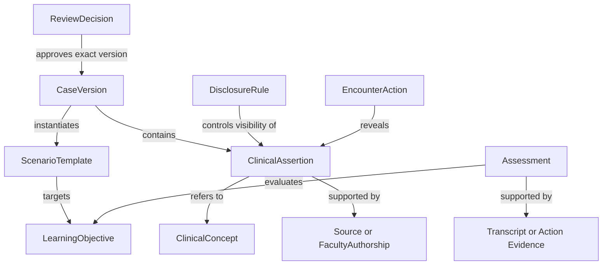

# Ontology-first knowledge and acquisition plan

Prepared October 10, 2026 from the current project discussion, prior Codex threads and repository research. The user requests the sequence **project KRAIL → ontology → knowledge base → database design → AI scenario generation**. This document defines the preparation work; it does not implement these layers or approve clinical content.

## Purpose and boundaries

Build a small, reviewed teaching knowledge base that supports coherent, reusable patient encounters. Begin with supplied TwinVerse cases and the faculty-authoring → approval → encounter/chart → evidence-linked debrief workflow. Keep the broader hospital vision through shared identifiers and separate later operations entities.

The main acquisition gap is reviewed teaching knowledge: reliable clinical relationships, disclosure rules, learning objectives, acceptable learner responses and evaluation examples. More patient rows alone will not provide these. No real patient records are required for the initial prototype.

## What each layer owns

| Layer | Responsibility | Initial artifact |
|---|---|---|
| Project KRAIL | Research questions, source inventory, evidence, decisions, conflicts, acquisition tasks and review status | Navigable research topics and source-backed claims |
| Ontology | Entity definitions, relationships, field meanings, scopes and constraints | Domain vocabulary and relation/constraint definitions |
| Knowledge base | Populated concepts, assertions, case versions, teaching rules and materials | Reviewed structured records with source links |
| Database, later | Persistence, indexing, retrieval, permissions and encounter records | Storage implementation derived from the domain contracts |
| AI generation, later | Retrieve approved knowledge and propose constrained scenario drafts | Structured, traceable drafts that pass checks and review |

A research-memory claim does not automatically become approved patient truth. KRAIL records a source disagreement; the knowledge base preserves the competing assertions and reviewer resolution; the approved case references that resolution. Database choice follows these semantics.

## Research and acquisition priorities

| Domain | Acquire or research | Ontology entities | Initial owner / acceptance |
|---|---|---|---|
| Patient cases | Reconcile supplied profiles and faculty CSV; preserve histories, medications, allergies, concerns and unknowns | PatientPersona, CaseVersion, HistoryItem, MedicationUse, Allergy, Symptom | Case/clinical owner: source mapping and review issues for all eight drafts |
| Clinical knowledge | Selected authoritative references, definitions, case-relevant relationships and consistency rules | ClinicalConcept, Condition, ClinicalRelationship, ConsistencyConstraint | Clinical educator: reviewed rationale for each critical case relationship |
| Chart content | Compatible vitals, labs, examination findings, notes and permitted teaching assets | Observation, DiagnosticReport, ChartArtifact, Unit, ReferenceRange | Case/clinical owner: units, time, case fit, asset rights and interpretation recorded |
| Patient perspective | Patient knowledge, beliefs, goals, barriers, volunteered information and reluctance | PatientBelief, Concern, Goal, Barrier, DisclosureRule | Clinical educator: authored answers and release rules; no demographic stereotypes inferred |
| Encounter workflow | Learner actions, chart access, prerequisites, escalation and role authority | EncounterStage, Action, Prerequisite, Role, Authority | Clinical educator: observable student workflow and acceptable alternatives |
| Learning and assessment | Supplied rubric, faculty objectives, evidence requirements, N/A and safety-review rules | LearningObjective, RubricVersion, Criterion, EvidenceRequirement | Evaluation owner with faculty: criterion-to-evidence mapping; scale and applicability explicit |
| Scenario templates | Teaching situations, allowed variations, initial state, scripted events and completion conditions | ScenarioTemplate, VariationConstraint, Event, Transition | Case/backend owners: reusable template with no patient-specific code assumptions |
| Validation | Expected-answer questions, contradiction/disclosure probes and faculty-rated sample encounters | TestCase, ExpectedAnswer, TranscriptEvidence, ReviewerJudgment | Evaluation owner: small reviewed reference set with explicit expected behavior |
| Provenance and review | Original source locators, versions, rights, transformations, limitations and approval scope | SourceDocument, EvidenceClaim, LicenseRecord, ReviewDecision | Research owner: each promoted record has traceable provenance and status |

These priorities refine the [sixteen-domain acquisition manifest](data-acquisition-manifest.json). The initial ontology includes terminology and provenance even though broad terminology ingestion is deferred.

## Minimal entity and relationship contract

Separate general clinical concepts from case-specific assertions and encounter discoveries.

For each `ClinicalAssertion`, preserve:

- Stable ID, subject, predicate/value and clinical concept reference.
- Assertion origin: patient-reported, chart-recorded, observed or author-established.
- Finding state: present, explicitly absent, unknown or pending. Missing content is not a negative finding.
- Clinical time or interval, distinct from source publication time and review time.
- Units and applicable reference ranges when numeric; do not assume one universal range.
- Source ID, version and exact locator; transformations and unresolved conflicts.
- Review status: draft, disputed, corrected or approved, with reviewer and approval scope.
- Disclosure rule and audience: educator-only, patient-known, initially learner-visible or discoverable.

Keep assertion origin, clinical time, review status and visibility as separate fields. A patient belief is not a confirmed diagnosis. A general source relationship is not proof that a particular persona has a condition. Pending tests cannot become normal results. Approval attaches to an exact case version; edits require review and existing encounters retain their original version.

Clinical chart resources can draw on [FHIR's Observation boundaries](https://hl7.org/fhir/R4/observation.html), which distinguish observations from diagnoses. Use selected [RxNorm](https://www.nlm.nih.gov/research/umls/rxnorm/index.html) drug concepts and [LOINC](https://loinc.org/) observation concepts where useful. Record terminology releases and mapping uncertainty. These mappings do not require a full FHIR server or bulk terminology import. Research terminology rights before redistribution.

## Source acquisition order and current status

The [October 10 dataset review](discord-dataset-review-2026-10-10.md) owns resource inspection details and limitations. Current local checks reconfirmed eight normalized patient objects and eight faculty CSV rows; the supplied rubric JSON is present.

| Resource | Status / proposed use | Remaining gap |
|---|---|---|
| TwinVerse eight profiles + faculty CSV | Acquired synthetic drafts; primary seeds for the knowledge base | Reconcile overlaps and inconsistencies; faculty approval |
| Supplied seven-domain 1–4/N/A rubric | Acquired example; pair with objective-level evidence and versioned faculty configuration | Automated-scoring agreement and adaptation review; no psychometric validation established |
| Five clinician personas | Acquired fictional role examples for later handoff/supervisor entities | Role/scope review; not actual staffing |
| Original faculty teaching cases | Priority acquisition: expected discoveries, accepted responses, disclosure and rationale | Mentor availability and explicit review |
| Authoritative reference passages | Acquire selected evidence for the chosen cases and objectives | Original-source inspection, applicability and reuse terms |
| Chart artifacts | Prefer authored synthetic reports initially; add objective-relevant licensed assets | Individual-file rights, case fit and clinical interpretation |
| Validation examples | Must be created and reviewed alongside the first cases | Expected labels and faculty agreement are not yet established |
| Sevaro synthetic kits | Acquired operations/workflow examples; later replay and schema research | Cross-track reuse expectations; no RWJUH calibration |
| NHANES, CGMacros, MetaboNet | Specialized population/glucose research leads | Exact package/schema, cohort, rights and processing suitability |
| Vlada/CMS aggregate context | Optional dated cost, access, facility or patient-experience cards | Product-level provenance; sponsor query entitlement remains untested |
| Patient–Doctor corpus and pathology table | Secondary leads | Source history, reuse rights and clinical applicability before adoption |

Do not join unrelated biomarker rows to a persona to fill gaps. Do not turn aggregate population prevalence, public bed counts or financial measures into individual clinical facts or real-time resource state.

For later hospital operations, research Facility, Unit, Bed, Equipment, StaffRole, Shift, Eligibility, Queue, Arrival, Transfer, ServiceStage, Policy and CapacityState. Obtain process definitions, aggregate demand/routes, staffed versus physical capacity, skill constraints, stage-specific durations, disruptions and independent validation observations. Numerical simulation owns operational consequences; the LLM may narrate them. Public directories and Sevaro synthetic events do not calibrate an RWJUH ED model.

## Preparation milestones

These are proposed deliverables and acceptance criteria, not completed work. The existing weekend [action plan](action-plan.md) remains the submission guide; this sequence prepares its reusable case contract without adding a database or whole-hospital simulator to the immediate scope.

| Milestone | Accountable owner | Acceptance |
|---|---|---|
| 1. Evidence inventory | Research owner | Each candidate records acquired versus lead, source/version, rights, limitations and review needs |
| 2. Ontology vocabulary | Research + backend owners | Entity meanings, IDs and relation semantics documented; unknown/pending/negative and audience states distinct |
| 3. Eight case drafts | Case/clinical owner | Source-to-record mapping and inconsistency log; no silent clinical corrections |
| 4. Two reviewed cases | Faculty reviewer + case owner | Critical facts, objectives, disclosure, authored answers, compatible artifacts and version-specific approval |
| 5. One reusable template | Backend + case owners | A new case can use generic fields; variation bounds and scripted transitions explicit |
| 6. Reference evaluation set | Evaluation owner + faculty | Expected-answer/disclosure checks and evidence-based rubric examples reviewed; disagreements retained |
| 7. Knowledge-base readiness | Integration owner | Records navigable by ID and source; drafts distinguishable from approved content; exportable contracts |

The target of two approved cases is a proposed milestone. No faculty approval is established by this research. If review remains unavailable, preserve drafts and report that gap.

## Later AI scenario generation

A generator receives a teaching objective, learner level, approved template, selected knowledge and permitted variation constraints. It emits a structured draft, traceable source/fact references, explicit unknowns and proposed disclosure/events.

Generation → structural checks → cross-field and temporal consistency checks → artifact/rights checks → clinical review → approved version → encounter. Store generator/model version and relevant generation parameters for reproducibility. Sources support claims; a generated citation alone is not proof of support.

Initially pre-generate and cache approved scenarios. Later immediate variations may operate within a faculty-approved envelope, with validation and logging. New clinical relationships, diagnoses, treatment responses or out-of-envelope changes remain drafts requiring review. The interview itself retrieves the approved case version rather than regenerating clinical truth on each turn.

No KRAIL project, ontology implementation, populated approved knowledge base, database or generator was created by this planning document. This is the acquisition and domain-design handoff for that work.
