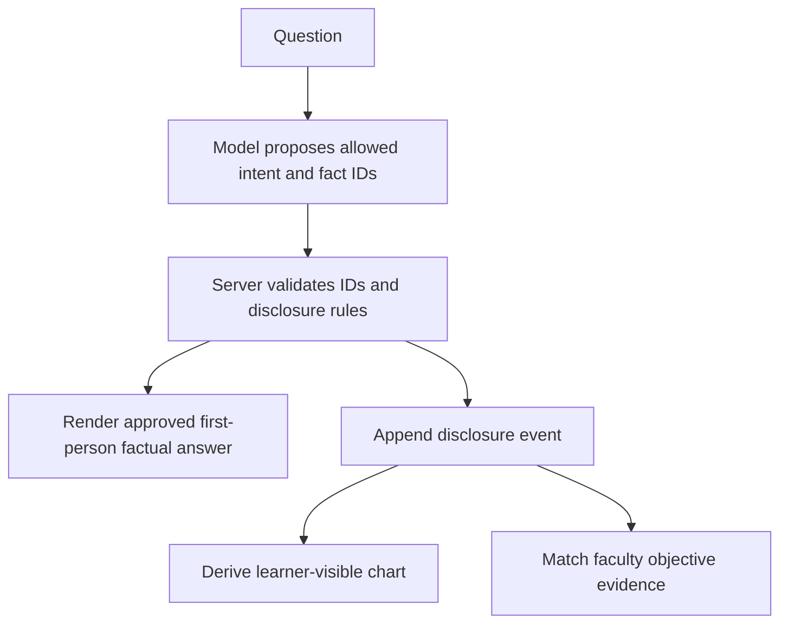

# Technical and data research

Checked October 9, 2026. These are design proposals and source findings, not implemented or tested functionality. The goal is one reusable faculty-approved case → student encounter → explainable debrief. See [action plan](action-plan.md), [TwinVerse requirements](twinverse-requirements.md), and [source register](source-register.md).

## Requirements and resource fit

The new TwinVerse DOCX confirms the generic faculty Studio/encounter/feedback architecture, but supplies no JSON schema or starter code. Base also requires knowledge/artifact management, review/correction, explicit release timing, reusable profiles, encounter logs and complete objective-linked feedback. Our contract below is a proposal; it is not an organizer format. [TwinVerse requirements](twinverse-requirements.md)

AWS is the first hosting/provider option after a bounded account/region/permission/model/expiry check. A minimal deployment maps the existing contract onto API Gateway, Lambda, DynamoDB and S3, with Bedrock behind the server's provider adapter. Confirm each service, region, permission, model and quota in the temporary workshop account before relying on it. ElevenLabs speaks the already approved response; it must not maintain a separate medical truth. Kiro is a development assistant, and Anakin.io is optional reference ingestion. [Sponsor resources](sponsor-resources.md)

Vlada supplies public aggregate coverage/cost/provider/quality sources, not the histories or clinical cases this product needs. Keep any optional aggregate debrief card separate from patient facts and grading. The guide's Monday October 12, 9 a.m. ET cutoff belongs to Vlada alone. Use a permitted dated snapshot or omit the card; confirm AWS and other providers' own end times. Public RWJUH maps/directories cannot calibrate ED staffing or patient flow; the Rapid Admit interior reference describes an admission route that bypasses the ED. [Data sources and hospital context](data-sources-and-hospital-context.md)

## Smallest viable implementation

Use the team's familiar web stack: one browser UI, one server API, one provider adapter, one persistent case/encounter store. TypeScript end to end is a reasonable default if the team already knows it; otherwise retain the stack the fastest two builders share. Do not split the team across a game engine, Python service, separate agent platform, and clinical database before the encounter works. Choose the actual model after a 20-question case test and a latency check, not from an unverified model leaderboard.

The integration lead should freeze these conceptual endpoints before parallel development: create/update a draft case; validate/approve a version; start an encounter from that version; submit a student turn/request; fetch learner-visible chart; finish/debrief; reset to a new encounter. Each mutation carries an encounter ID, expected state version and request ID so retries do not duplicate findings. Approval and private case fields are enforced on the server; hiding controls in the UI is insufficient.

Suggested minimum case contract:

| Entity | Required content |
|---|---|
| Case | ID/version; draft/approved status; author/reviewer and review time; intended learner; title; prebrief |
| Fact | Stable ID; value/text and units if relevant; patient knowledge; approved first-person answer; release condition; unknown/unspecified handling |
| Finding/asset | ID; report/asset reference/type; case version and linked fact IDs; initial/on-question/on-request availability and release rule; synthetic/teaching label; source/permission metadata; faculty correction/review status |
| Objective | ID; faculty-authored criterion; linked fact/action IDs; acceptable evidence; sequencing/communication criteria where relevant; strength/next-attempt feedback; optional/critical status; source/rationale |
| Encounter | Approved case version; learner-visible fact IDs; turn/event ledger; status; explicit reset semantics |
| Source | URL/title/date; what it supports; license/asset permission; whether it is rationale or an adapted source |

Validation catches missing fields, invalid references, duplicate IDs, incompatible versions and contradictory explicit entries. It cannot automatically establish medical correctness. Faculty review remains necessary. Distinguish a known negative, a patient who does not know, and a field the author did not supply. A patient's lack of awareness of a test result differs from a test not performed.

Keep diagnostic answer keys and faculty-only rubrics out of student API responses and browser bundles. The case's patient-visible subset differs from the chart-visible subset; an LLM playing the patient should not be given unrestricted hidden diagnostic truth. For P0, factual answers come directly from approved content. Free paraphrasing introduces a separate semantic validation problem and should wait.

## Provider and clinical-content boundaries

The server owns clinical truth and encounter state. The model proposes intent/fact selection and may provide constrained social phrasing; it cannot create medical facts. Bedrock access does not itself make output grounded. The server checks selected IDs, release conditions and case version before sending the approved response. In text-only fallback mode, approved answers, chart disclosure and objective evidence should still work.

ElevenLabs, if enabled after Base passes, speaks the already approved text. It must not run an independent patient agent with a different answer key. Voice transport should preserve the same encounter ID and event path as text. Missing or failed voice permissions cannot block the text encounter. Avoid attaching the faculty-only diagnosis or assessment rubric to a patient voice agent's general prompt.

Knowledge sources belong in Studio with a clear role: evidence supporting a faculty-authored fact, rationale for a learning objective, or a teaching artifact permitted for display. A paper or guideline retrieval hit is not automatically a publishable patient answer. If model-assisted ingestion is used, generated case content stays draft until reviewed, corrected, checked for consistency and approved. Do not allow a source-page instruction to change application behavior or publish a draft.

Patient self-report and chart facts can differ when the faculty explicitly defines both observations and a reasoning objective. Preserve attribution and uncertainty. A lab that disagrees with a self-report does not itself establish the cause; the first architecture video's glucose/nonadherence example must not become an automatic clinical inference. The application must not invent a discrepancy to make an encounter more interesting.

## Evaluation plan

Measure actual paths and preserve failed observations. The following are prototype targets, not achieved results or validated clinical benchmarks.

| Check | Proposed method |
|---|---|
| Clinical grounding | At least 30 dialogue probes across approved cases; human review of unsupported clinical claims divided by factual claims; target zero unsupported claims in this finite set |
| Intent selection | Expected allowed fact/action IDs versus observed IDs; include paraphrases, mixed questions, leading questions, requests for absent data and attempts to override the case |
| Cross-channel consistency | At least 10 repeated/paraphrased questions; compare dialogue, chart, artifacts and debrief for values, units, identity/history and time |
| Disclosure | Author-defined trigger passes, premature release fails; hidden answer key stays server-side; unknown, missing and negative remain distinct |
| Versioning and reliability | Draft rejects, invalid references reject, isolated sessions, approved-version retention, safe duplicate/retry behavior, refresh/reset and provider-timeout fallback |
| New-case reusability | A teammate or faculty author creates new content through Studio; immediately run complete encounter and debrief, with zero code edits; record authoring/startup time |
| Objective feedback | At least 10 decisions against faculty/case-owner expectations; show observed/missed/not-assessable plus evidence; report disagreement and corrective action |
| Communication coaching | Evidence for structure, sequence, clarity, empathy and professionalism; strengths plus an actionable next-attempt suggestion; no claim of validated empathy scoring |
| Usability and latency | Three short observer sessions if available; record completion/confusion/correction time; report text response timings, slowest and p95 only when enough samples exist |

A reference link in a prompt and a language model's confident explanation do not establish grounding. Deterministic authored-answer rendering reduces factual invention while leaving intent-selection, release-rule and case-authoring errors to test. Free medical paraphrasing adds a separate semantic validation problem.

## Synthetic records: Synthea is optional, not the case author

[MITRE's Synthea](https://synthetichealth.github.io/synthea/) generates realistic but non-real patient histories. Its [official repository](https://github.com/synthetichealth/synthea) supports conditions, medications, allergies, observations, encounters and FHIR R4 export under Apache-2.0 software licensing. Generated histories can supply background context; they do not automatically define a clinically coherent teaching encounter, patient persona, asset interpretation or assessment rubric.

For Sunday, two small original synthetic cases reviewed by faculty are faster than generating an entire hospital population. If using Synthea later, preserve generator version, seed, relevant module versions and export settings. Separate the synthetic background from the faculty-approved scenario. Check the repository's NOTICE and terminology/export-format licenses; open software licensing is not blanket permission for every clinical terminology or image.

Do not depend on new access to credentialed datasets. The original [AgentClinic project](https://github.com/samuelschmidgall/agentclinic) includes benchmark variants; real-record-derived variants may have dataset access conditions. Read the actual dataset and source licenses before copying examples. Static exam vignettes are also not automatically reusable. No clinical images, patient records, or benchmark cases were downloaded by this research task.

## EHR structure and interoperability

FHIR is a useful future mapping: [Encounter R4](https://hl7.org/fhir/R4/encounter.html) represents the interaction context; [Observation R4](https://hl7.org/fhir/R4/observation.html) supports observations with units/times; reports/assets should retain their own source and release rules. Use explicit published-version references when implementing. A chart using similar field names is not automatically FHIR conformant, connected to Epic, or clinically interoperable.

[MedAgentBench](https://arxiv.org/abs/2501.14654) describes 300 physician-written tasks across ten categories in a FHIR-compliant virtual EHR environment. The paper's evaluated model results are historical benchmark results, not a recommendation for the team's provider. Its relevance is the environment/action contract and explicit task verification.

[AgentClinic's original paper](https://arxiv.org/abs/2405.07960) and [published study](https://pmc.ncbi.nlm.nih.gov/articles/PMC13324710/) study interactive patient, measurement and tool workflows. The authors identify LLM-based measurement generation as a source of potential errors and suggest database-backed tools. Our approved chart/answer contract is an engineering response to that concern; its performance still must be measured.

## Future hospital-administration simulation

This is a separate model from a virtual patient's conversation. [Agent Hospital](https://arxiv.org/abs/2405.02957) explores LLM doctor/nurse/patient agents and agent learning in a simulated hospital. Benchmark gains do not establish realistic ER wait times, staffing needs, or clinical outcomes.

A concrete operational precedent is [Tan et al., 2026](https://pubmed.ncbi.nlm.nih.gov/42460593/): an ambulance/ED discrete-event model calibrated using 19,570 ambulance records and data from a 250-bed hospital. This illustrates the data and calibration burden behind capacity scenarios; its results cannot be transplanted to Rutgers. [Wenzel et al., 2026 preprint](https://arxiv.org/abs/2605.13345) combines discrete-event and agent-based modeling and checks configurations/metrics against literature. Its multi-agent optimization component is a proof of concept, and the source is a preprint.

A later operational model would need documented arrival patterns, acuity mix, service-time distributions, shift calendars, bed/equipment constraints, routing/boarding rules and validation against observed independent periods. Compare simulated waiting/throughput/utilization with reference data and report sensitivity/uncertainty. The brainstorming recording's 10/30/40-minute examples are hypotheticals, not valid model calibration; see [recording and decisions](recording-and-decisions.md). For the current submission, a visual queue is context only and should not be presented as an operational forecast.

## Research boundary

The sources support design choices and explain what requires later validation. They do not establish that the planned app is clinically valid, pedagogically effective, hallucination-free or a functioning hospital twin. At the research cutoff, preparation had produced planning/research documents rather than a prototype. No clinical effectiveness, operational prediction or hackathon-submission acceptance is established by these documents. Publishing research does not verify that the planned application works.
